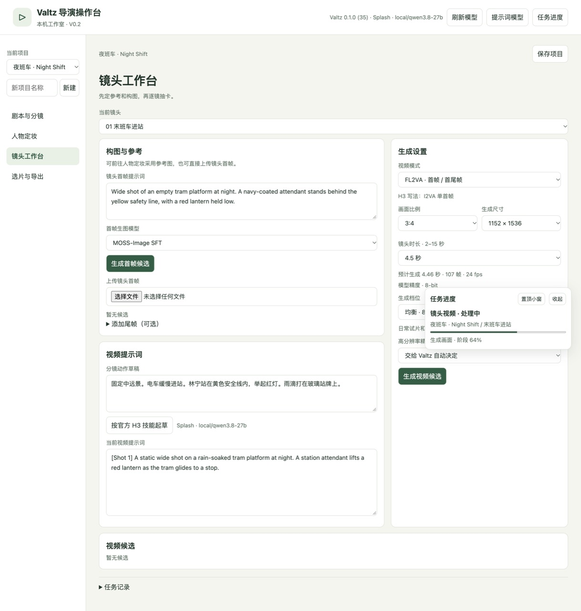
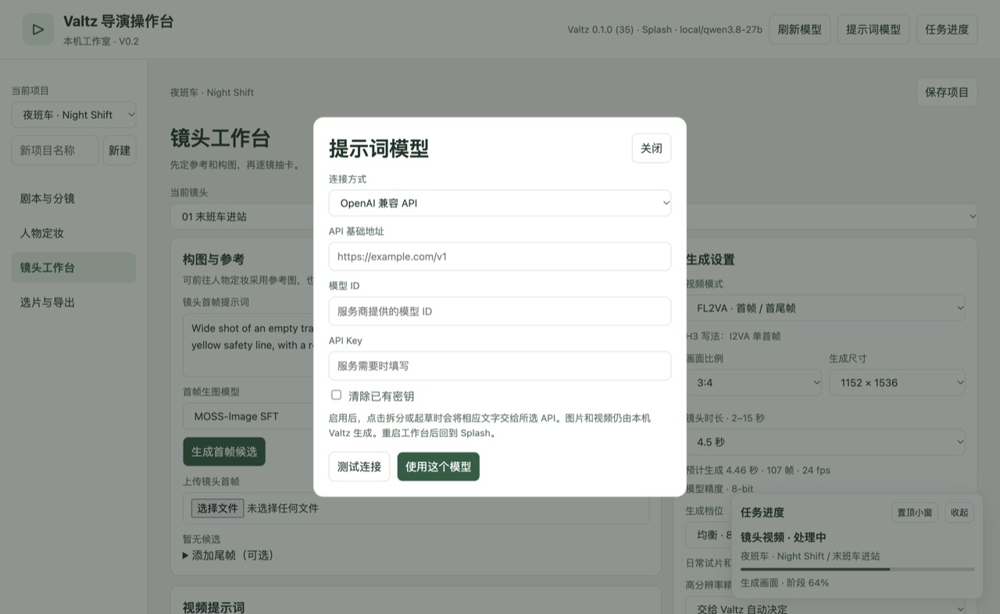

# Valtz Director Workbench

A local macOS workbench for directing individual AI video shots with Valtz. Start with a script, choose the cast and opening frames, generate a few takes, and export the clips you want to edit in DaVinci Resolve.

**Version 0.2** · Chinese interface · English documentation

## Screenshots

These screenshots show the workbench with a fictional demo project and illustrative progress.

| Storyboard and progress | Shot settings | Text model connection |
| --- | --- | --- |
| [](docs/storyboard.jpg) | [](docs/shot-workbench.jpg) | [](docs/model-connection.jpg) |

## What you can do

- **Turn a script into a shot list.** Import TXT or DOCX, or paste a script. Review the proposed cast and shots before adding them. Edit the action brief, opening-frame prompt, and video prompt for each shot.
- **Build a reusable cast.** Upload a JPEG or PNG likeness reference, or generate portrait candidates with one of the installed Valtz image models. Choose the look you want to reuse.
- **Direct each shot.** Use an opening frame, optional closing frame, or ordered character references. Set the aspect ratio, dimensions, and a requested duration from 2 to 15 seconds. The workbench shows the nearest supported H3 frame count within that range.
- **Draft prompts with the official H3 guide.** Splash is the default text model. The workbench distinguishes first-frame-only I2VA, first-and-last-frame FL2VA, and reference-based Ref2VA. Review each draft before adopting it.
- **Compare Valtz generation profiles.** See the sampling steps that the installed Valtz build resolves for Speed, Balanced, and Quality. Pika Flex and HyperFlow appear when the installed model supports them. High-resolution refinement has its own control.
- **Watch generation while you work.** The floating panel follows you across projects and workbench pages. On browsers that support Document Picture-in-Picture, open an always-on-top mini window. Percentages refer to the current Valtz stage.
- **Keep the good takes.** Preview and choose takes independently. Export the selected clips as H.264 MP4 or ProRes 422 HQ MOV, with a shot manifest. Edit the clips in your own timeline.

## Getting started

1. Install Valtz on macOS and install the models you want to use from its Capabilities screen. This workbench uses the installed Valtz controller and does not bundle model weights.
2. Use Python 3.9 or newer and put `ffprobe` on your PATH, or set `VALTZ_DIRECTOR_FFPROBE` to its location.
3. For H3 prompt drafting, install [MiniMax's official H3 prompt-writing skill](https://github.com/MiniMax-AI/MiniMax-H3/tree/main/skills/h3-prompt-writing). The default path is `~/.dsh/skills/h3-prompt-writing`. Alternatively, set `VALTZ_DIRECTOR_H3_SKILL` to the directory containing `SKILL.md` and `references/`.
4. Open `Launch.command` or run:

   ```sh
   python3 server.py
   ```

Open [127.0.0.1:8776](http://127.0.0.1:8776/) if the browser does not open automatically. The service listens on loopback. The app reads Valtz's installed capabilities at launch and when you click **Refresh models**.

### Text model connections

The default is a running Splash OpenAI-compatible API at `http://127.0.0.1:8000/v1`, using `local/qwen3.8-27b`. In the workbench, open **Prompt model** and enter the base URL, model ID, and optional API key for another compatible service. The **Test connection** button reads the model list. Providers that do not implement that list may still support chat completions.

When you enable an external provider and request a draft, it receives the text needed for that draft. Image and video generation still run through local Valtz. Connection secrets stay in process memory. Restarting the workbench returns to Splash. The provider must accept the OpenAI-compatible Chat Completions format.

### Local storage and configuration

Projects and generated candidates default to `~/Library/Application Support/Valtz Director Workbench`. Exported clips go under `~/Downloads/Valtz 导演操作台` in a new folder per export.

| Setting | Purpose |
| --- | --- |
| `VALTZ_APP` | Path to the installed Valtz application |
| `VALTZ_DIRECTOR_DATA_PATH` | Project, cache, and candidate directory |
| `VALTZ_DIRECTOR_MODELS_PATH` | Override the model directory reported by Valtz |
| `VALTZ_DIRECTOR_DATA_UUID`, `VALTZ_DIRECTOR_DATA_SUBDIR` | Resolve an external data volume by UUID, with subdirectory relative to that volume |
| `VALTZ_DIRECTOR_MODELS_UUID`, `VALTZ_DIRECTOR_MODELS_SUBDIR` | Resolve an external model volume by UUID |
| `VALTZ_DIRECTOR_SPLASH_URL`, `VALTZ_DIRECTOR_SPLASH_MODEL` | Default local Splash connection |
| `VALTZ_DIRECTOR_H3_SKILL` | Directory containing the official H3 prompt-writing skill |
| `VALTZ_DIRECTOR_FFPROBE` | Path to the media inspection executable |

This is an independent workbench for an existing Valtz installation. Generation is serialized within the workbench. The exact installed models, profiles, and native operations available may vary with the Valtz build.
