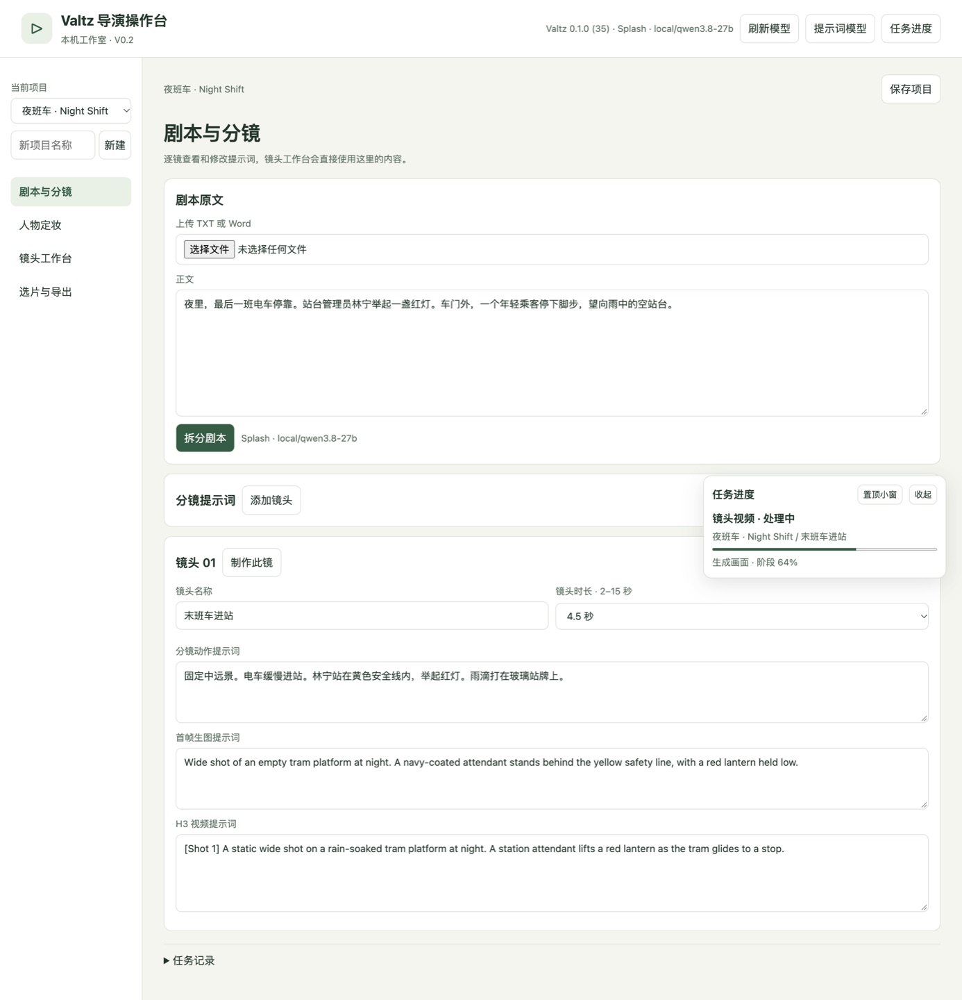

# Valtz Director Workbench

A local macOS workbench for directing individual AI video shots with Valtz. Start with a script, choose the cast and opening frames, generate a few takes, and export the clips you want to edit in DaVinci Resolve.

**Version 0.4** · Chinese interface · English documentation

## Screenshots

These screenshots use a fictional demo project and show an earlier version of the interface.

| Storyboard and progress | Shot settings | Text model connection |
| --- | --- | --- |
| [](docs/storyboard.jpg) | [](docs/shot-workbench.jpg) | [](docs/model-connection.jpg) |

## What you can do

Choose **AI 剧**, **AI-MTV**, or **AI 换脸视频** at the top. Each mode has its own projects and workspace.

- **Turn a script into a shot list.** Import TXT or DOCX, or paste a script. Review the proposed cast and shots before adding them. Edit the action brief, opening-frame prompt, and video prompt for each shot.
- **Build a reusable cast.** Upload a JPEG or PNG likeness reference, or generate portrait candidates with one of the installed Valtz image models. Choose the look you want to reuse.
- **Direct each shot.** Use an opening frame, optional closing frame, or ordered character references. Set the aspect ratio, dimensions, and a requested duration from 2 to 15 seconds. The workbench shows the nearest supported H3 frame count within that range.
- **Draft prompts with the official H3 guide.** Splash is the default text model. The workbench distinguishes first-frame-only I2VA, first-and-last-frame FL2VA, and reference-based Ref2VA. Review each draft before adopting it.
- **Compare Valtz generation profiles.** See the sampling steps that the installed Valtz build resolves for Speed, Balanced, and Quality. Pika Flex and HyperFlow appear when the installed model supports them. High-resolution refinement has its own control.
- **Watch generation while you work.** The floating panel follows you across projects and workbench pages. On browsers that support Document Picture-in-Picture, open an always-on-top mini window. Percentages refer to the current Valtz stage.
- **Keep the good takes.** Preview and choose takes independently. Export the selected clips as H.264 MP4 or ProRes 422 HQ MOV, with a shot manifest. Edit the clips in your own timeline.

## What's new in 0.4

- **Generate selected shots in sequence.** Select shot numbers in the shot workbench. The queue generates and adopts an opening frame, drafts and applies the H3 prompt, then produces a video candidate for you to review. It pauses on errors and keeps completed candidates.
- **Carry the same look across cuts.** A frame from the previous shot anchors the clothes, hair, and accessories of recurring characters. New characters use their own approved references. The batch workflow uses shot context to decide when to apply this setting.
- **See what's been adopted.** Character names and numbered shots have clickable overviews with checkmarks for adopted looks or video takes. The progress panel refreshes about every 0.8 seconds while a job is active.
- **Use practical defaults.** Qwen-Image 2.1 is preferred for character portraits when installed. New shots default to Ref2VA and the available Pika Flex profile, which reports six steps on Valtz build 35. A batch shot with no character references uses FL2VA.
- **Scale selected clips during export.** Choose the original size or a target short edge of 720, 1080, or 1440 pixels. A 3:4 clip at a 1080-pixel short edge exports at 1080 × 1440. Scaling preserves framing and audio and keeps clips already at the target size or above. FFmpeg uses Lanczos scaling.

## Getting started

1. Install Valtz on macOS and install the models you want to use from its Capabilities screen. This workbench uses the installed Valtz controller and does not bundle model weights.
2. Use Python 3.9 or newer and put `ffprobe` on your PATH, or set `VALTZ_DIRECTOR_FFPROBE` to its location.
3. For H3 prompt drafting, install [MiniMax's official H3 prompt-writing skill](https://github.com/MiniMax-AI/MiniMax-H3/tree/main/skills/h3-prompt-writing). The default path is `~/.dsh/skills/h3-prompt-writing`. Alternatively, set `VALTZ_DIRECTOR_H3_SKILL` to the directory containing `SKILL.md` and `references/`.
4. Open `Launch.command` or run:

   ```sh
   python3 server.py
   ```

Open [127.0.0.1:8776](http://127.0.0.1:8776/) if the browser does not open automatically. The service listens on loopback. The app reads Valtz's installed capabilities at launch and when you click **Refresh models**.

### Music video mode

Choose **AI-MTV** at the top and create a project. Import WAV or extract the first audio track from MP4. Add plain lyrics or LRC lyrics with timecodes, select up to five approved cast looks, and choose a treatment and visual style. Listen to the source audio and mark musical changes as optional cut anchors. The workbench computes shot windows from the measured audio length. The text model drafts the treatment and storyboard from the lyrics and planning data. The audio and cast images stay on your computer.

Add the approved draft to the shot workspace to generate and choose takes. Each shot keeps its source audio interval. Export includes a separate WAV master and a placement manifest for Resolve. Beat detection and lip synchronization are not automatic in this version.

The progress panel can play a two-note chime when a job succeeds. Interact with the page at least once so your browser can enable audio. Use the sound button to turn it off.

### Video face replacement

Create an **AI 换脸视频** project and import an MP4 or MOV. Run recognition, inspect the face group thumbnails, and assign one single-person JPEG or PNG reference to each group you want to change. Leave a group unassigned to keep its original face. Try the short preview before processing the full video, then save the accepted output to Downloads.

The worker uses a local InsightFace detector, identity embeddings, and a face replacement model on the CPU. It skips uncertain matches and reuses source audio. Crowded shots, occlusion, and strong profile views may need manual review.

To set up this mode on another Mac, use a separate Python 3.12 environment and install the worker dependencies. Make sure FFmpeg and ffprobe are available.

```sh
python3.12 -m venv ~/.venvs/valtz-director-face
~/.venvs/valtz-director-face/bin/python -m pip install 'insightface==1.0.1' onnxruntime
export VALTZ_DIRECTOR_FACE_PYTHON="$HOME/.venvs/valtz-director-face/bin/python"
python3 server.py
```

Use compatible model files you already have in `VALTZ_DIRECTOR_FACE_MODELS` (defaults to `~/.insightface/models`). The expected layout contains `buffalo_l/det_10g.onnx`, `buffalo_l/w600k_r50.onnx`, and `inswapper_128.onnx`. Model files are not included or downloaded by the workbench.

### Text model connections

The default is a running Splash OpenAI-compatible API at `http://127.0.0.1:8000/v1`, using `local/qwen3.8-27b`. In the workbench, open **Prompt model** and enter the base URL, model ID, and optional API key for another compatible service. The **Test connection** button reads the model list. Providers that do not implement that list may still support chat completions.

Choose **Codex · ChatGPT account** to use the locally installed Codex CLI with an existing ChatGPT login. This option uses Codex account quota. Custom API providers must accept the OpenAI-compatible Chat Completions format. Test connection checks the Codex login or reads the selected API's model list.

When you request a draft from a remote text provider, that provider receives the relevant text. Image and video generation run through local Valtz. Custom API keys stay in process memory. Restarting the workbench returns to Splash.

### Local storage and configuration

Projects and generated candidates default to `~/Library/Application Support/Valtz Director Workbench`. Exported clips go under `~/Downloads/Valtz 导演操作台` in a new folder per export.

| Setting | Purpose |
| --- | --- |
| `VALTZ_APP` | Path to the installed Valtz application |
| `VALTZ_DIRECTOR_DATA_PATH` | Project, cache, and candidate directory |
| `VALTZ_DIRECTOR_MODELS_PATH` | Override the model directory reported by Valtz |
| `VALTZ_DIRECTOR_DATA_UUID`, `VALTZ_DIRECTOR_DATA_SUBDIR` | Resolve an external data volume by UUID, with subdirectory relative to that volume |
| `VALTZ_DIRECTOR_MODELS_UUID`, `VALTZ_DIRECTOR_MODELS_SUBDIR` | Resolve an external model volume by UUID |
| `VALTZ_DIRECTOR_SPLASH_URL`, `VALTZ_DIRECTOR_SPLASH_MODEL` | Default local Splash connection |
| `VALTZ_DIRECTOR_H3_SKILL` | Directory containing the official H3 prompt-writing skill |
| `VALTZ_DIRECTOR_FFPROBE` | Path to the media inspection executable |
| `VALTZ_DIRECTOR_FFMPEG` | Path to FFmpeg for audio import, reference-frame extraction, and scaled exports |
| `VALTZ_DIRECTOR_FACE_PYTHON` | Python with InsightFace, ONNX Runtime, and OpenCV installed |
| `VALTZ_DIRECTOR_FACE_MODELS` | Local folder with detector, recognizer, and replacement weights |

This is an independent workbench for an existing Valtz installation. Generation is serialized within the workbench. The exact installed models, profiles, and native operations available may vary with the Valtz build.
